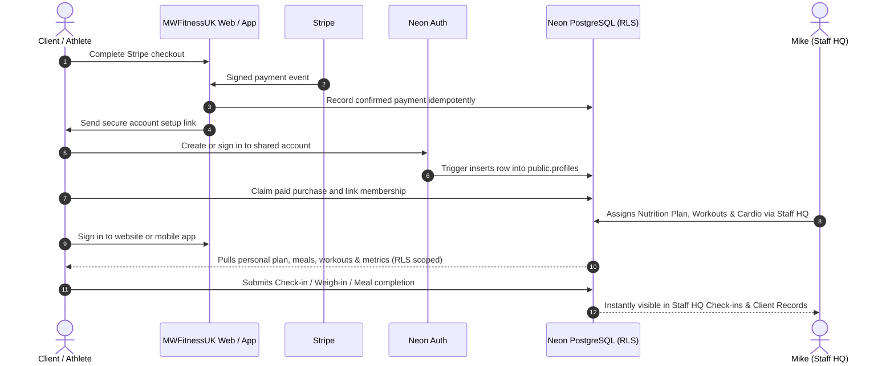

# Implementation Plan: Live Neon Backend, Staff HQ, and Mobile App Synchronization

> **Historical implementation plan — reviewed 2026-10-26.** The issue list and proposed changes below are not a reliable statement of current outstanding work. In the current mobile `src/lib/remote.ts`, the calendar, progress-photo, weigh-in and cardio fields appear aligned with the checked-in migrations, and cardio calories are stored in notes rather than a non-existent column. Re-verify against the current source and run `npm test` in the mobile repository before reopening those older items. Live Neon persistence and RLS still require dedicated end-to-end tests.

This plan audits, aligns, and connects both repositories:
1. **Website & Staff HQ (`mike`)** — Live production management centre, real database interactions with Neon, public form lead capture, and local API server mounts.
2. **Mobile App (`MW-FITNESS-APP-MOBILE`)** — Member data synchronization with Neon (check-ins, workouts, nutrition, cardio, water/steps, progress photos, messages), calendar queries, and UI/UX state handling.

---

## Architecture Overview


The image above is permanently saved in:
- [`mike/docs/mw-fitness-architecture.jpg`](file:///Users/christopherjcallaghan/Documents/mwfitnessapp/mike/docs/mw-fitness-architecture.jpg)
- [`MW-FITNESS-APP-MOBILE/docs/mw-fitness-architecture.jpg`](file:///Users/christopherjcallaghan/Documents/mwfitnessapp/MW-FITNESS-APP-MOBILE/docs/mw-fitness-architecture.jpg)

This plan is permanently saved in:
- [`mike/docs/MW-FITNESS-LIVE-NEON-PLAN.md`](file:///Users/christopherjcallaghan/Documents/mwfitnessapp/mike/docs/MW-FITNESS-LIVE-NEON-PLAN.md)
- [`MW-FITNESS-APP-MOBILE/docs/MW-FITNESS-LIVE-NEON-PLAN.md`](file:///Users/christopherjcallaghan/Documents/mwfitnessapp/MW-FITNESS-APP-MOBILE/docs/MW-FITNESS-LIVE-NEON-PLAN.md)

---

## Member Accounts & Purchase Lifecycle

### Current implementation status

- The website member portal is available at `/account` and supports sign-in, session restore, sign-out, password reset, and membership status/history.
- Website and mobile use the same Neon Auth identity and `public.profiles` records. The mobile app remains the primary training and coaching experience.
- Neither application currently provides a paid-checkout signup flow. Website checkout creates a Stripe Checkout session, but no verified Stripe webhook provisions an account or links a purchase to a membership.
- The website account does not present plan catalogue prices as paid amounts. Verified receipts and purchase history remain pending a persisted Stripe transaction ledger.
- Public Neon Auth signup and email-verification behavior are controlled by deployed branch configuration; check it before enabling signup UI.

### Target paid-member lifecycle



1. **Individual Identity**: A member uses one Neon Auth identity and profile across website and mobile; do not create separate website credentials.
2. **Complete Data Isolation**: PostgreSQL Row Level Security (RLS) enforces that members can **only** read and write their own records:
   - Their assigned nutrition plan (`nutrition_plans`)
   - Their meal completions (`nutrition_daily_logs`)
   - Their scheduled & completed workouts (`workout_sessions`)
   - Their wellbeing check-ins (`checkins`)
   - Their weight logs (`progress_logs`) and private photos (`progress_photos`)
   - Their water & step tracker (`daily_metrics`) and cardio logs (`cardio_logs`)
   - Their 1-on-1 private chat with Mike (`coach_messages`)
3. **Staff Control**: Mike (Staff HQ) has coach/admin permissions to view all athlete profiles, review check-ins, prescribe coach notes, update nutrition targets, and assign workouts.
4. **Payment Authority**: Only a verified Stripe payment event may create paid access. Browser redirects and checkout email alone must not grant membership or link a purchase to an existing profile.

---

## Live vs Demo Mode Rules

> [!IMPORTANT]
> **Live Mode Rules**:
> - **Normal appearance**: Live accounts do NOT need to say "Live" or display cluttering badges. Live is the natural default state.
> - **Real Persistence**: Everything pushed and pulled connects directly to the shared Neon database.
>
> **Demo Mode Rules**:
> - **Prominent Demo Label**: Demo mode MUST clearly say **"DEMO MODE · Sample Data"** so it is unmistakable.
> - **Local Storage Only**: Demo mode NEVER writes to Neon. All demo interactions stay in local storage or in-memory state.

---

## Identified Issues & Required Fixes

### 1. Website & Staff HQ Backend (`mike`)
1. **Local Server Route Mounts (`server.mjs`)**:
   - `GET /api/plans` and `GET /api/products` exist in `api/` (for Vercel), but were **never registered in `server.mjs`**.
   - Running `npm run server` locally caused public pricing and product requests to return 404.
   - **Fix**: Mount `plans` and `products` route handlers in `server.mjs`.
2. **Staff HQ Live Data Flow Audit**:
   - Ensure every management component (`UsersAdmin`, `PlansAdmin`, `MembershipsAdmin`, `NutritionAdmin`, `WorkoutsAdmin`, `ProgrammesAdmin`, `VideosAdmin`, `CheckinsAdmin`, `ProgressAdmin`, `MessagesAdmin`, `LeadsAdmin`, `MemberActivityAdmin`, `CommunicationsAdmin`, `ClientRecordsAdmin`) connects reliably to Neon, handles loading/saving states with feedback, and handles empty/error states without falling back to demo data.
3. **Public Lead Capture (`api/send-mail.mjs` & `api/_leads.mjs`)**:
   - Ensure all public form submissions (`ConsultationModal`, `ContactScreen`, `AppScreen` waitlist, `ShwagScreen`) persist into `public.website_leads` via `DATABASE_URL` before email notification is attempted.
   - Ensure visitor forms display clear feedback: loading spinner, validation errors, and confirmation message.

### 2. Mobile App (`MW-FITNESS-APP-MOBILE`)
1. **Schema & Column Mismatches in `remote.ts`**:
   - **`checkins` query**: `loadMemberCalendarEvents()` selects non-existent columns (`checkin_type, weight, energy_rating, sleep_hours`). The actual Postgres schema in `0001_init.sql` has `checkin_date, sleep, energy, stress, soreness, status, client_notes, coach_notes, coach_prescription`.
   - **`progress_photos` query**: selects `taken_at, photo_type, notes`. The actual schema in `0006_daily_checkins_progress_photos.sql` has `recorded_on, caption, mime_type, photo_data`.
   - **`progress_logs` query**: selects `logged_at, weight_kg, notes`. The actual schema in `0001_init.sql` has `recorded_on, weight, note`.
   - **`cardio_logs` query & insert**: references `calories_burned`, which is not in `0007_member_metrics_supplements_cardio.sql` (columns are `completed_at, duration_minutes, activity, average_heart_rate, notes`).
   - **Fix**: Align all queries in `remote.ts` and `calendarEvents.ts` to match the exact database column definitions so queries never fail with PostgreSQL column-not-found errors.
2. **Mobile Data Push & Pull Validation**:
   - **Daily Check-in**: verify `saveDailyCheckin()` correctly inserts into `checkins` and that history loads the coach's review and prescription.
   - **Nutrition Plan**: verify `loadNutritionDetail()` correctly pulls `nutrition_plans` by `profile_id` and `day_type`, and `saveNutritionDailyLog()` pushes daily completions to `nutrition_daily_logs`.
   - **Workout Sessions**: verify `loadSessions()` and `completeWorkoutSession()` update `workout_sessions`.
   - **Metrics & Cardio**: verify `saveDailyMetrics()` upserts into `daily_metrics` and `logCardio()` inserts into `cardio_logs`.
   - **Weigh-in & Photos**: verify `logWeight()` and `saveProgressPhoto()` push to `progress_logs` and `progress_photos`.
   - **Messages**: verify `sendCoachMessage()` and `loadMessages()` interact with `coach_messages`.
3. **UI / UX Correctness**:
   - Live mode looks clean without unnecessary "Live" labels.
   - Demo mode is prominently marked with a Demo badge.
   - Guard against empty screen flicker: loading skeletons or spinners on all async fetches.
   - Meaningful empty states (e.g. "No check-ins submitted yet", "No workouts scheduled for today").
   - Action buttons disable during submissions to avoid duplicate rows.

---

## Proposed Changes

### Component 1: Website Backend & Local Server (`mike`)

#### [MODIFY] `server.mjs`
- Import and mount `plans` handler on `GET /api/plans`.
- Import and mount `products` handler on `GET /api/products`.
- Ensure JSON responses match Vercel serverless function outputs.

#### [MODIFY] `src/components/admin/AdminScreen.tsx`
- Ensure live mode is the default, primary workflow.
- Remove redundant "Live" badges from the normal live view.
- When demo mode is activated, clearly tag it with `Demo · Sample data · Local only`.
- Ensure error boundaries and retry buttons exist on all live tabs.

#### [MODIFY] `src/components/admin/VideosAdmin.tsx`
- Ensure UI gracefully guides coach to apply migration `0009_coaching_videos.sql` when missing, and operates fully when applied.

---

### Component 2: Mobile App Remote Client (`MW-FITNESS-APP-MOBILE`)

#### [MODIFY] `src/lib/remote.ts`
- Fix `loadMemberCalendarEvents()` column selections:
  - `checkins`: select `id, checkin_date, created_at, sleep, energy, stress, soreness, status, client_notes`
  - `progress_photos`: select `id, recorded_on, caption, mime_type, created_at`
  - `progress_logs`: select `id, recorded_on, weight, note, created_at`
  - `cardio_logs`: select `id, completed_at, activity, duration_minutes, average_heart_rate, notes`
- Fix `logCardio()` to store calories in notes if column is not yet present, or ensure compatibility.
- Harden error handling and return types across all remote helpers.

#### [MODIFY] `src/lib/calendarEvents.ts`
- Ensure event mapping from remote records handles the corrected columns without undefined values or NaN scores.

#### [MODIFY] `src/screens/DailyCheckinScreen.tsx` & `src/screens/CoachCheckinScreen.tsx`
- Verify live check-in submission and history display.
- Add clear loading and confirmation states.

#### [MODIFY] `src/screens/NutritionPlanScreen.tsx` & `src/screens/NutritionScreen.tsx`
- Ensure live coach plans load seamlessly by `day_type`.
- Ensure meal completion check-boxes persist to `nutrition_daily_logs`.

#### [MODIFY] `src/screens/MemberToolsScreen.tsx`
- Ensure water & steps metrics sync live with `daily_metrics`.
- Add visual save confirmation indicator.

---

### Component 3: Database Migrations (`neon/migrations`)

#### [NEW] `MW-FITNESS-APP-MOBILE/neon/migrations/0009_coaching_videos.sql` & `mike/db/migrations/20261021_coaching_videos.sql`
- Create `public.coaching_videos` table with RLS:
  - Columns: `id (uuid)`, `title (text)`, `description (text)`, `category (text)`, `video_url (text)`, `thumbnail_url (text)`, `duration_seconds (integer)`, `level (text)`, `active (boolean)`, `created_at (timestamptz)`, `updated_at (timestamptz)`.
  - Policies: public/authenticated read active videos; coaches/admins manage all videos.

---

## Verification Plan

### Automated Tests & Quality Checks
1. **Website (`mike`)**:
   ```bash
   npm run --prefix /Users/christopherjcallaghan/Documents/mwfitnessapp/mike build
   npx --prefix /Users/christopherjcallaghan/Documents/mwfitnessapp/mike tsc --noEmit
   ```
2. **Mobile App (`MW-FITNESS-APP-MOBILE`)**:
   ```bash
   npm run --prefix /Users/christopherjcallaghan/Documents/mwfitnessapp/MW-FITNESS-APP-MOBILE lint
   npx --prefix /Users/christopherjcallaghan/Documents/mwfitnessapp/MW-FITNESS-APP-MOBILE tsc --noEmit
   ```
3. **Local API Server Route Verification**:
   ```bash
   curl -s http://localhost:8787/api/health
   curl -s http://localhost:8787/api/plans?kind=online
   curl -s http://localhost:8787/api/products
   ```

### Manual Verification
1. **Website Staff HQ (Live)**:
   - Navigate to `/admin`.
   - Sign in with staff credentials.
   - Verify Overview loads real counts from Neon.
   - Verify all 15 tabs load their live datasets from Neon without error.
   - Test a status change on an enquiry in Website Leads (`website_leads`).
   - Test assigning a plan or updating a meal template in Nutrition (`nutrition_templates`).
2. **Public Website Forms**:
   - Open Consultation Modal, submit a test booking.
   - Check that the lead immediately appears in Staff HQ under Website Leads.
3. **Mobile App**:
   - Sign in with a member account.
   - Verify Home screen loads active profile, workouts, and nutrition.
   - Complete a daily check-in; verify it saves and appears in Staff HQ Check-ins.
   - Log water/steps in Member Tools; verify it updates `daily_metrics`.
   - Complete a meal in Nutrition; verify meal completion persists after page switch.
   - Open Calendar; verify check-in and workout events render without errors.
